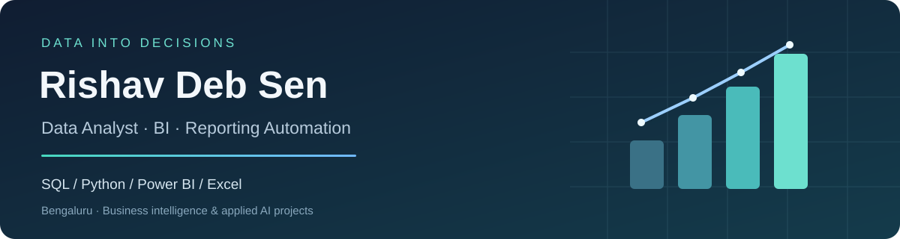
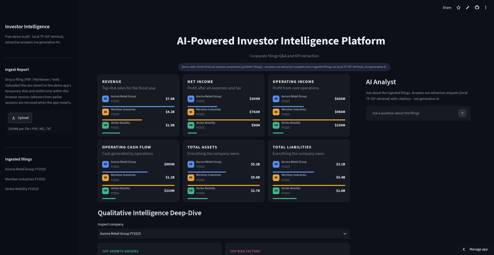
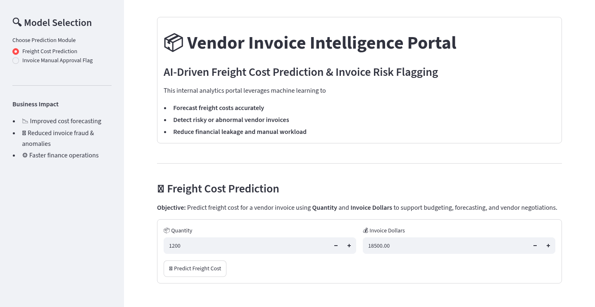
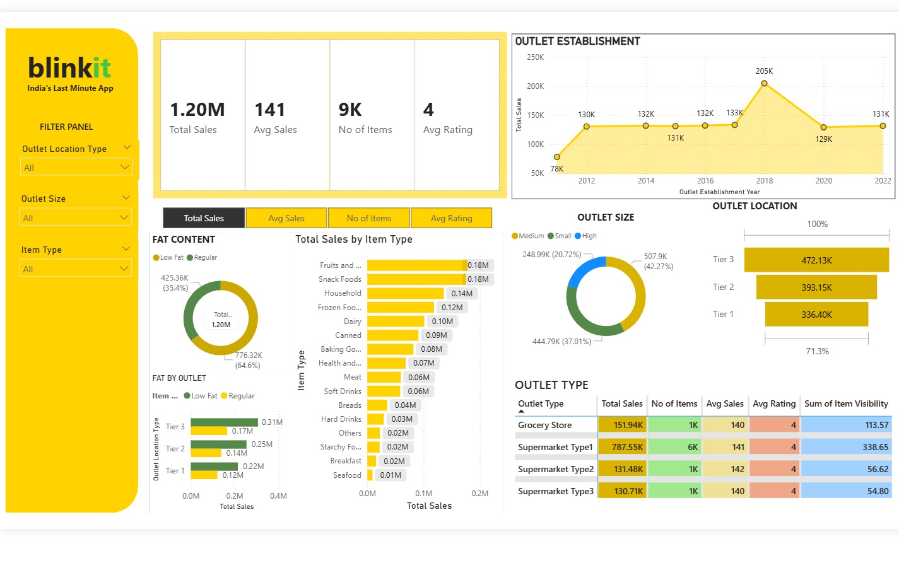

# Hi, I'm Rishav Deb Sen

### Data Analyst | SQL · Python · Power BI · Excel | AI & ML Projects

I build dashboards, automate reporting, and turn data into clear answers to business questions. My portfolio also explores machine learning and retrieval-based document Q&A.

Based in Bengaluru. Previously a Data Associate at Wipro. Open to Data Analyst, BI Analyst, and junior AI roles. Available to join immediately.

[Connect on LinkedIn](https://www.linkedin.com/in/rishav-d-824a392a1)

---

## Professional experience

**Data Associate · Wipro | Jan 2025 - Feb 2026**

Supported reporting and dashboards for a multinational transportation client.

- Automated reporting workflows with Excel VBA and Python, reducing report turnaround by 30%.
- Built Power BI dashboards for cross-functional and global stakeholders.
- Applied controls validation and documented reconciliation rules to improve reporting quality.

## How I approach a project

**Business question → Data checks → Analysis → Dashboard or application → Findings and limitations**

I aim to make each repository easy to review: explain the problem, show the result, document how to run it, and be clear about what has and has not been tested.

---

## Explore my projects

[Investor Intelligence](#ai-powered-investor-intelligence-platform) · [Invoice ML](#vendor-invoice-intelligence) · [Power BI Dashboard](#blinkit-grocery-sales-dashboard)

Select a project, open the code, or try the deployed Investor demo. Click the expandable sections for implementation details.

### [AI-Powered Investor Intelligence Platform](https://github.com/rishavdebsen/AI-Powered-Investor-Intelligence-Platform)

A RAG-style document Q&A and financial KPI dashboard for exploring company filings.

 

*Free-hosted demo may be asleep. Use the wake button on Streamlit if prompted. Screenshot shows the project interface, not live market data.*

<b>See retrieval pipeline, tools, and implementation scope</b>

- Ingests PDF, Markdown, and text filings with structure-aware chunking.
- Returns retrieved excerpts with source citations and extracts headline financial KPIs.
- Combines a FastAPI backend with a Streamlit interface and Mixpanel funnel tracking.

**Tools:** Python · FastAPI · Streamlit · SQLite · RAG architecture · TF-IDF · Mixpanel

**RAG implementation scope:** Document ingestion, chunking, TF-IDF retrieval, and source-cited excerpts are implemented. The default answer is extractive, not LLM-generated. The optional OpenAI/Azure generation path is unverified.

---

### [Vendor Invoice Intelligence](https://github.com/rishavdebsen/Invoice-Intelligence-Freight-Cost-Prediction-Invoice-Risk-Flagging-Machine-Learning-sql-python)

A machine learning project for estimating freight costs and flagging invoices for manual review.

*Real screenshot of the repository app running locally with its default example inputs. UI impact statements describe intended uses, not measured business results. This is not a hosted demo or a verified prediction result.*

**Invoice data → SQL features → Regression and classification → Streamlit predictions**

<b>See models, evaluation, and app details</b>

- Uses SQL joins and aggregations to create features from vendor invoice and purchase data.
- Compares Linear Regression, Decision Tree, and Random Forest models for freight prediction.
- Tunes a Random Forest classifier with GridSearchCV and 5-fold cross-validation; evaluates precision, recall, F1, and the confusion matrix.
- Separates training and inference into reusable scripts, with predictions available through a Streamlit app.

**Tools:** SQL · SQLite · Python · pandas · scikit-learn · Streamlit

**Scope:** Invoice flags are based on business-rule labels, not independently verified fraud outcomes.

---

### [Blinkit Grocery Sales Dashboard](https://github.com/rishavdebsen/blinkit-grocery-sales-dashboard)

An interactive Power BI dashboard for exploring sales by product category, outlet size, and location tier.

<b>See dashboard features, tools, and dataset credit</b>

- Presents sales, item counts, average sales, and ratings with interactive filters.
- Includes a companion pandas script for checking dataset summaries.
- Built following the Data Tutorials walkthrough using its practice dataset, with credit in the repository.

**Tools:** Power BI · DAX · Python · pandas

---

## About me

- In my projects, I use SQL and Python to prepare data, compare models, and build interactive tools.
- My interests sit at the intersection of business intelligence, automation, and practical AI applications.

## Tools I use

| Area | Tools and methods |
| --- | --- |
| Analysis | SQL joins, CTEs, window functions, aggregations; Python, pandas, NumPy |
| Dashboards and reporting | Power BI, DAX, Power Query, Excel VBA, Tableau |
| Project databases | MySQL, SQLite |
| AI and document retrieval | RAG-style document Q&A, TF-IDF retrieval, structure-aware chunking, source citations, financial KPI extraction |
| Machine learning | scikit-learn, Linear Regression, Decision Trees, Random Forest, feature engineering, GridSearchCV, cross-validation, model evaluation |
| Application projects | FastAPI, Streamlit, retrieval-based document Q&A, Mixpanel event tracking |

**Project focus:** document retrieval and RAG architecture in Investor Intelligence; regression, classification, and model evaluation in Vendor Invoice Intelligence. These are portfolio projects, separate from my Wipro experience.

## Connect

[LinkedIn](https://www.linkedin.com/in/rishav-d-824a392a1) · [GitHub](https://github.com/rishavdebsen)
